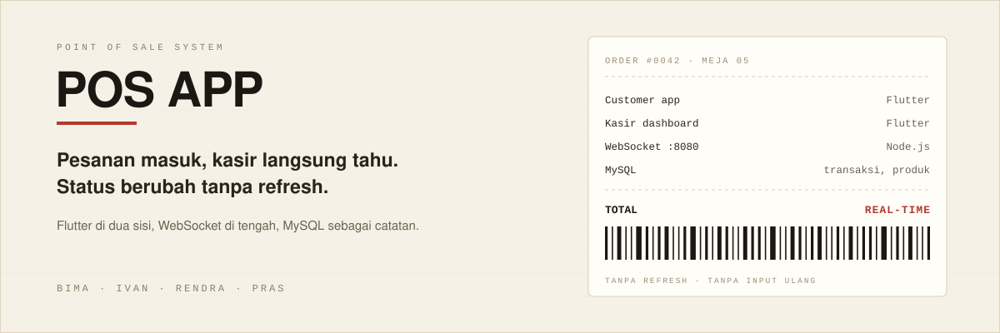
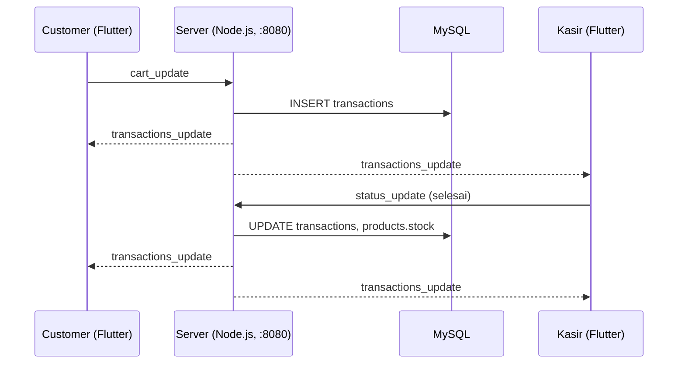

<p align="center">
  
</p>

<p align="center"><b>Sistem Point of Sale real-time: customer pesan dari meja, kasir konfirmasi dalam hitungan detik.</b></p>
<p align="center">Flutter untuk customer dan kasir dalam satu aplikasi, Node.js WebSocket sebagai jantung realtime, MySQL sebagai sumber data.</p>

<p align="center">
  
  
  
  
</p>

<p align="center">
  <a href="#instalasi">Instalasi</a> ·
  <a href="#struktur-proyek">Struktur Proyek</a> ·
  <a href="#protokol-websocket">Protokol WebSocket</a> ·
  <a href="#troubleshooting">Troubleshooting</a> ·
  <a href="#kontributor">Kontributor</a>
</p>

---

## Daftar Isi

- [Fitur](#fitur)
- [Tech Stack](#tech-stack)
- [Arsitektur](#arsitektur)
- [Struktur Proyek](#struktur-proyek)
- [Prasyarat](#prasyarat)
- [Instalasi](#instalasi)
- [Protokol WebSocket](#protokol-websocket)
- [Troubleshooting](#troubleshooting)
- [Kontributor](#kontributor)

---

## Fitur

### Customer
- Login per meja
- Melihat menu (appetizer, main course, dessert, minuman)
- Menambah dan mengurangi item di keranjang
- Mengirim pesanan ke kasir secara real-time
- Melacak status pesanan (menunggu dikonfirmasi → diproses → selesai)
- Memberi rating produk (1–5 bintang + komentar)

### Kasir / Admin
- Dashboard real-time untuk semua pesanan per meja
- Memperbarui status pesanan
- Manajemen produk (create, read, update, delete)
- Manajemen user/karyawan (create, read, update, delete)
- Stok berkurang otomatis saat pesanan berstatus selesai
- Laporan: produk terlaris, produk stok rendah, ringkasan produk dan karyawan, riwayat penjualan
- Export laporan ke PDF
- Pengiriman nota pembelian via email

### Autentikasi
- Customer login dengan nomor meja
- Kasir/Admin login dengan email dan password
- Sesi disimpan di SharedPreferences

---

## Tech Stack

| Lapisan  | Teknologi                                                                 |
|----------|---------------------------------------------------------------------------|
| Frontend | Flutter (Dart), Provider, http, SharedPreferences, pdf & printing, mailer |
| Backend  | Node.js, ws (WebSocket), mysql2                                           |
| Database | MySQL 5.7+                                                                |

---

## Arsitektur



---

## Struktur Proyek

```
pos-app-flutter/
├── app/                        # Aplikasi Flutter
│   ├── assets/                 # Font dan gambar menu
│   └── lib/
│       ├── core/services/      # Komunikasi API dan logika bisnis
│       ├── models/             # Model data
│       ├── providers/          # State management (Provider)
│       ├── screens/            # UI: admin, auth, cashier, customer
│       ├── theme/              # Tema aplikasi
│       ├── utils/              # PDF, email, format mata uang
│       └── widgets/            # Komponen UI reusable
│
└── server/                     # Backend Node.js
    ├── index.js                # WebSocket server
    └── db.js                   # Helper database
```

---

## Prasyarat

- [Flutter SDK](https://docs.flutter.dev/get-started/install) v3.0+
- [Node.js](https://nodejs.org/) v14+
- [MySQL Server](https://dev.mysql.com/downloads/) v5.7+
- Git

---

## Instalasi

### 1. Clone Repository

```bash
git clone https://github.com/bimadji/pos-app-flutter.git
cd pos-app-flutter
```

### 2. Setup Database

Buat database `pos_app`:

```sql
CREATE DATABASE pos_app;
```

Tabel yang digunakan server:
- `transactions`: `table_number`, `items_json`, `total_amount`, `status`
- `products`: `name`, `stock`

### 3. Setup Server

```bash
cd server
npm install ws mysql2
node index.js
```

Output yang diharapkan:

```
WebSocket server running on ws://0.0.0.0:8080
```

Konfigurasi koneksi saat ini ditulis langsung di `server/index.js`:

| Parameter | Nilai     |
|-----------|-----------|
| host      | localhost |
| user      | root      |
| password  | (kosong)  |
| database  | pos_app   |
| WS port   | 8080      |

Ubah nilai tersebut sesuai environment Anda sebelum digunakan di jaringan.

### 4. Setup Aplikasi Flutter

```bash
cd app
flutter pub get
flutter run
```

Ubah alamat server pada kode klien Flutter (`lib/core/services/`) menjadi:

```
ws://<IP-server>:8080
```

---

## Protokol WebSocket

| Type                  | Arah                 | Payload                                                | Keterangan                                                  |
|-----------------------|----------------------|--------------------------------------------------------|-------------------------------------------------------------|
| `cart_update`         | Customer → Server    | `table_number`, `customer_name`, `items`, `total`      | Disimpan ke database lalu di-broadcast                      |
| `status_update`       | Kasir → Server       | `table_number`, `status`                               | Memperbarui status; saat `selesai`, stok produk dikurangi   |
| `transactions_update` | Server → Semua klien | `transactions`, `status`                               | Dikirim saat klien terhubung dan setiap ada perubahan       |

Contoh `cart_update`:

```json
{
  "type": "cart_update",
  "table_number": 5,
  "customer_name": "Budi",
  "items": [
    { "name": "Nasi Goreng", "qty": 2, "price": 15000 }
  ],
  "total": 30000
}
```

Contoh `status_update`:

```json
{
  "type": "status_update",
  "table_number": 5,
  "status": "selesai"
}
```

---

## Troubleshooting

| Masalah                      | Solusi                                                                                 |
|------------------------------|----------------------------------------------------------------------------------------|
| WebSocket connection refused | Pastikan server berjalan dan alamat IP di klien benar. Port 8080 harus dapat diakses.  |
| Database connection error    | Periksa host, user, password, dan nama database di `server/index.js`.                  |
| Port 8080 already in use     | Hentikan proses yang memakai port tersebut, atau ubah port di server dan konfigurasi klien. |
| Flutter dependencies error   | Jalankan `flutter clean && flutter pub get`.                                           |

---

## Kontributor

| No | Nama                       | GitHub                                                      |
|----|----------------------------|-------------------------------------------------------------|
| 1  | Bima Adji Kusuma           | [@bimadji](https://github.com/bimadji)                      |
| 2  | Ivan Adrian Bhagaskara     | [@Ivanadrian31](https://github.com/Ivanadrian31)            |
| 3  | Muhammad Izza Narendra     | [@mizarendra](https://github.com/mizarendra)                |
| 4  | Muhamad Prabaswara Martana | [@prbswrmrtana_boop](https://github.com/prbswrmrtana_boop)  |
